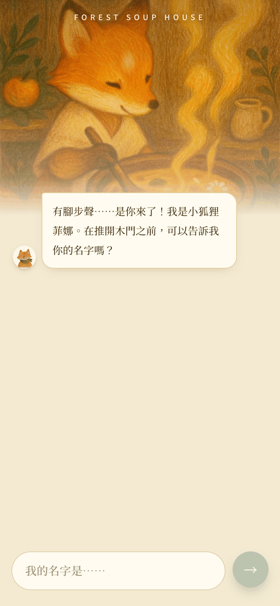
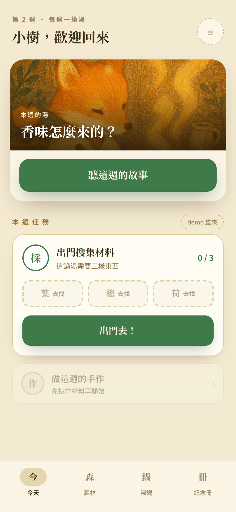
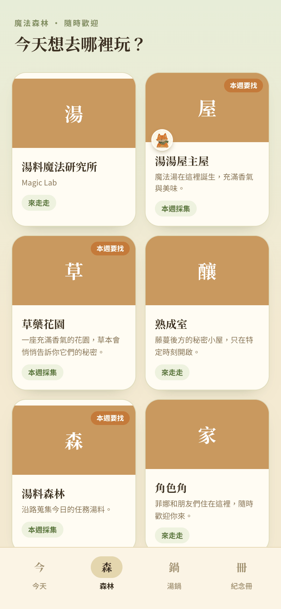
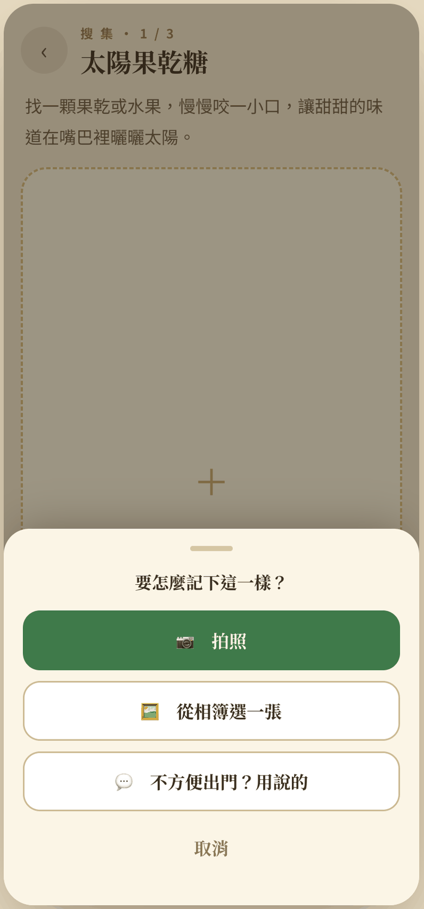
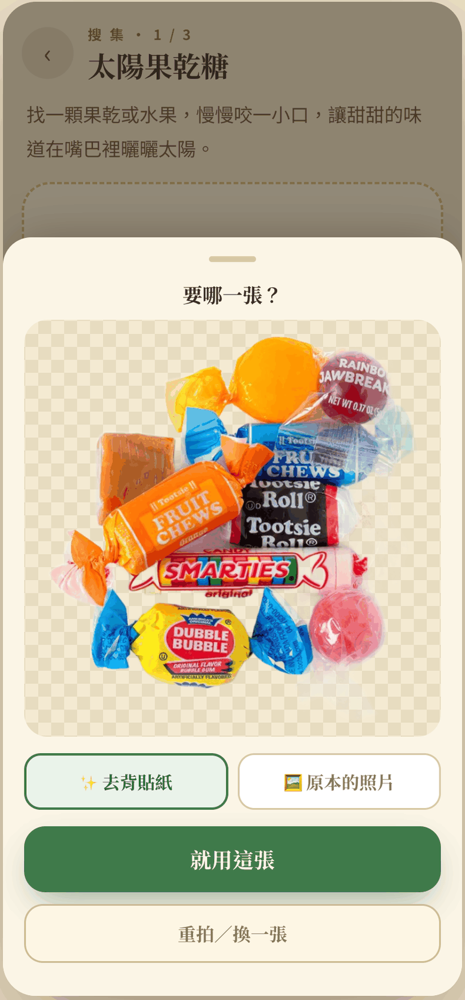
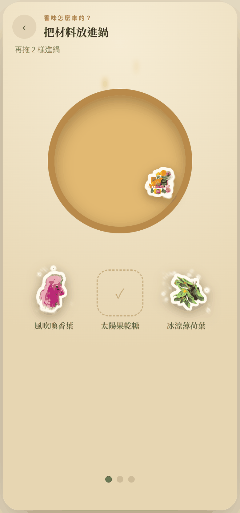
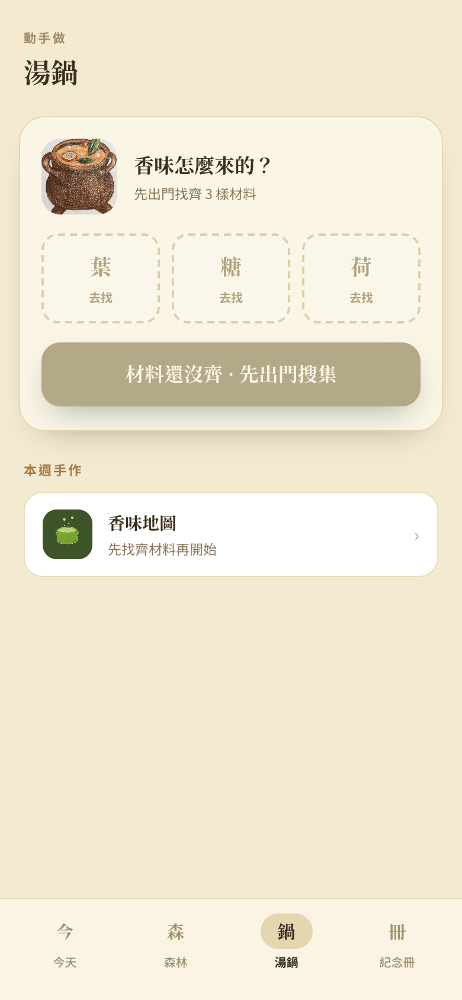
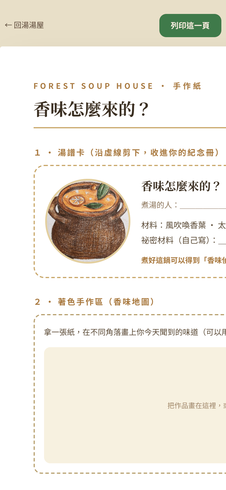

# Forest Soup House

A weekly story-and-play app for kids and grown-ups: hear a forest story, go outside to gather three real ingredients with the camera, then "cook" the week's magic soup together.

**Live:** https://forest-soup-house.vercel.app (mobile-first; best on a phone)

## Screenshots

| Onboarding | Today | Story | Forest | Capture | Sticker preview | Cook ritual | Soup pot | Printable |
|---|---|---|---|---|---|---|---|---|
|  |  |  |  |  |  |  |  |  |

## What it does

- **Weekly theme** – each week has a story (with narration), a soup, and three ingredients to find.
- **Gather** – take a photo or pick one from the album (or "say it" instead of going out). The photo is cut out in the browser and the child chooses the sticker or the original.
- **Cook ritual** – drag the gathered stickers into the pot, then stir in circles to finish the soup.
- **Forest** – nine playable places (garden, river, post office, magic lab…) with small local activities and a shared pantry.
- **Printable craft sheet** (`/print`) and a keepsake book tab.
- **Admin** (`/admin`) – password-protected CMS for themes, ingredients, places, characters and stories.

## Stack

- Next.js 16 (App Router), React 19, TypeScript, Tailwind CSS 4, CSS-variable design tokens
- Prisma + Supabase Postgres; deployed on Vercel
- In-browser background removal with `@imgly/background-removal` (WebGPU when available, CPU fallback)
- Children's photos stay on the device in IndexedDB; they are never uploaded

## My role

I designed and built this end to end: concept and story world, UX flows, visual design and design tokens, and the full-stack implementation (front end, data model, admin, deployment).

Illustrations and narration audio are AI-generated from my own concepts and art direction.

## How it evolved

- **v1 (Mar–Apr 2026)** – a storybook website: stories, soup cards, characters, locations, bilingual labels. Brief and UX structure: [`docs/V1_PRODUCT_BRIEF_AND_UX.md`](docs/V1_PRODUCT_BRIEF_AND_UX.md). Original concept notes: [`docs/PRODUCT_CONCEPT.md`](docs/PRODUCT_CONCEPT.md).
- **v2 (Jul 2026)** – rebuilt as a weekly parent-and-child app with four tabs (onboarding, camera gathering, soup-cooking ritual); content moved to Supabase with an admin.
- **v3 (Jul 2026)** – the forest: nine playable place overlays, full-screen story listening with synced narration, a shared pantry, and a reusable ingredient library across themes.
- **Oct 2026** – background-removal sticker preview and drag-into-the-pot cooking.

## AI workflow

Built with Claude Code. I owned the product direction, specs, and design; the agent helped implement, and I reviewed and tested every change.

## Security notes

- All database access is server-side through Prisma (server components and server actions); the browser never talks to the database.
- Row Level Security is enabled on every table (`prisma/enable-rls.sql`), so Supabase's public Data API can't read or write them.
- Secrets live only in `.env` (git-ignored); see `.env.example` for the variable names.

## Run locally

```bash
npm install
cp .env.example .env   # fill in your Supabase Postgres URLs and an admin password
npm run db:push        # create tables
npm run db:seed        # load sample content
npm run dev            # http://localhost:3000
```
